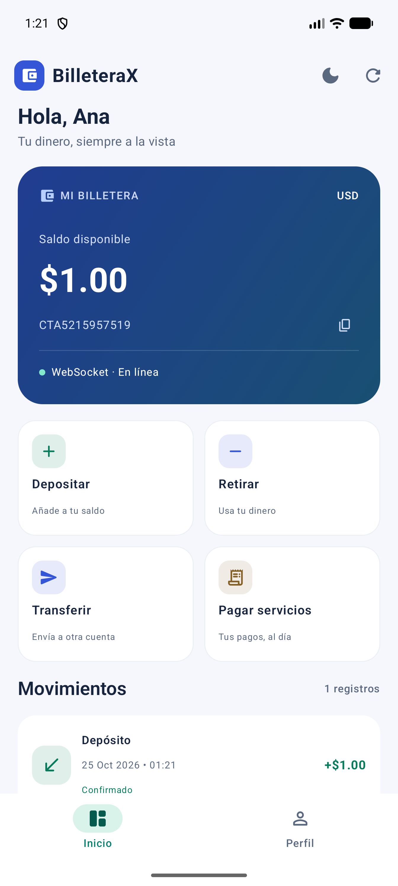
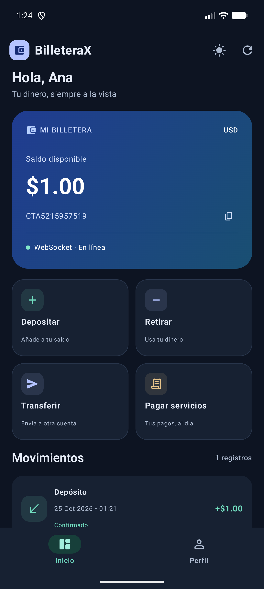
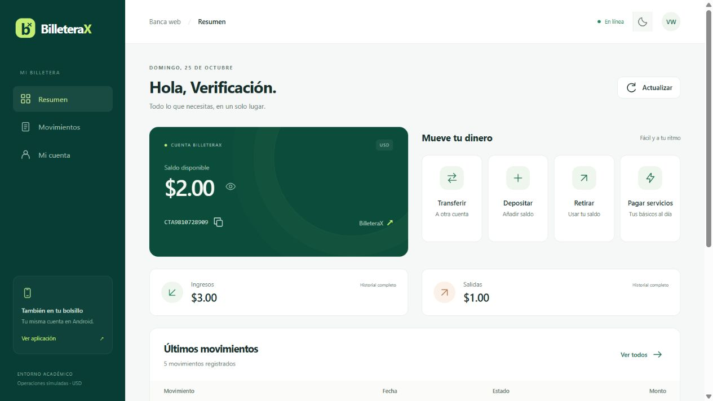

# BilleteraX

Billetera de laboratorio para Sistemas Distribuidos, ESPE. Android/Kotlin usa REST y WebSocket; Spring Boot/Java 21 confirma operaciones y mantiene H2 en archivo en Debian Server/VirtualBox. Room conserva comprobantes, último saldo sincronizado y operaciones pendientes en Android. El dinero y los servicios son simulados.

## GitHub y descarga

[Abrir banca web](https://29925-mosalvador.github.io/BilleteraX/) · [Repositorio](https://github.com/29925-mosalvador/BilleteraX) · [Descargar APK en Releases](https://github.com/29925-mosalvador/BilleteraX/releases) · [Compilación y pruebas](https://github.com/29925-mosalvador/BilleteraX/actions)

GitHub guarda el código, distribuye los instaladores y compila/prueba con Actions. La aplicación se ejecuta en Android y el servidor sigue en Debian. Ver [publicación y uso desde GitHub](docs/GITHUB.md), incluido el alcance del APK de CI y su firma temporal.

<p>
  
  
</p>

## Usar la aplicación 1.1.0

1. Encender DebianServer. El backend ya está actualizado en `http://192.168.18.76:8080/`.
2. Instalar el APK nuevo sobre BilleteraX, conservando sus datos. Abrir **Crear cuenta** e indicar nombre, usuario y contraseña. No se solicita correo ni verificación por correo.
3. Cada usuario recibe un número de cuenta propio y saldo inicial **$0.00**. Depositar un importe de laboratorio para empezar. Las cuentas antiguas CTA001/CTA002 se conservan, pero no se asignan automáticamente a un usuario nuevo.
4. Para entrar nuevamente, usar el mismo usuario y contraseña. La sesión queda guardada de forma cifrada en Android; la contraseña no se guarda allí. **Perfil → Cerrar sesión** permite cambiar de cuenta.
5. En **Perfil → Apariencia** elegir **Sistema**, **Claro** u **Oscuro**. En la pantalla de acceso también hay un botón para cambiar el tema y un engranaje para configurar el servidor.

El teléfono y Debian deben poder comunicarse en la misma red. La URL predeterminada es la de Debian. Ver [registro, base de datos y demostración](docs/ACCESO_USUARIOS.md).

## Desarrollar en Windows

Abrir `C:\Proyectos\BilleteraX\android` en Android Studio. Requisitos fijados: Java 21, Android SDK 36.1, Build Tools 35.0.0, AGP 8.13.2 y Gradle Wrapper 8.13.

```powershell
cd C:\Proyectos\BilleteraX
.\deployment\scripts\build.ps1 -JavaHome 'D:\AndroidStudio\jbr'
```

Para usar Debian basta con Run sobre el dispositivo. Para trabajar con otro backend local:

```powershell
.\deployment\scripts\start-local.ps1 -JavaHome 'D:\AndroidStudio\jbr'
```

Antes de registrarse/iniciar sesión, abrir el engranaje de acceso y guardar `http://10.0.2.2:8080/` en el emulador. El backend local escucha en `127.0.0.1`. Usuarios de un servidor no se copian automáticamente al otro. No abrir dos instancias sobre la misma H2. `-FreshDemo` crea otra base de laboratorio y conserva la anterior.

Para compilar por separado:

```powershell
$env:JAVA_HOME = 'C:\ruta\jdk-21'
.\backend\gradlew.bat -p backend test bootJar
.\android\gradlew.bat -p android assembleDebug assembleDebugAndroidTest testDebugUnitTest lintDebug
```

El APK está en `android/app/build/outputs/apk/debug/app-debug.apk`. Compartir la clave debug existente de Android Studio permite actualizar sin desinstalar; nunca incluirla en el repositorio.

## Demostración con Postman

Importar la colección y el entorno Debian de `postman/`. En el entorno, completar `username/password` con el usuario que está abierto en Android y ejecutar **00B Iniciar sesión**; guarda automáticamente `tokenA/sourceAccount`. Crear el emisor con `displayNameB/usernameB/passwordB` y **00C**, o entrar con **00D** si ya existe. Esos pasos guardan `tokenB/senderAccount`.

Ejecutar **08B Recargar emisora $20** y después **09 DEMO: B envía $20 a A**. El saldo de Android aumenta $20 y aparece la transferencia sin pulsar Actualizar. Los valores reales se introducen localmente; no exportar contraseñas ni sesiones en evidencias.

Las credenciales estáticas de CTA001/CTA002 se mantienen solo para compatibilidad con las pruebas antiguas. La app actual usa registro/login y no exige copiarlas. En el perfil dev los datos públicos históricos son `demo-cta001-local-only` y `demo-cta002-local-only`; Debian conserva sus propios valores de laboratorio en su archivo de entorno.

## Estructura

- `backend/`: API, registro/login, sesiones, transacciones, WebSocket y pruebas.
- `gateway/`: auxiliar público sin base bancaria; cola de mensajes y WebSocket.
- `protocol/`: mensajes de negocio compartidos entre auxiliar y Debian.
- `android/`: Compose/Material 3, MVVM, Retrofit/OkHttp, Room y pruebas.
- `deployment/`: compilación, instalación Debian con respaldo y systemd.
- `postman/`: colección y entornos sin credenciales privadas.
- `docs/`: arquitectura, guías, resultados y evidencias.

## Contrato REST

| Método y ruta | Función |
|---|---|
| GET `/actuator/health` | Salud pública, sin datos financieros |
| POST `/api/auth/register` | Nombre, usuario y contraseña; crea cuenta y sesión |
| POST `/api/auth/login` | Inicia sesión con usuario y contraseña |
| GET `/api/auth/me` | Perfil de la sesión |
| POST `/api/auth/logout` | Revoca la sesión actual y cierra su WebSocket |
| GET `/api/accounts/{id}/balance` | Saldo autorizado |
| GET `/api/accounts/{id}/transactions?page=0&size=50` | Historial paginado, máximo 200 |
| GET `/api/accounts/{id}/snapshot` | Saldo e historial consistentes |
| POST `/api/transactions/deposit` | Depósito simulado |
| POST `/api/transactions/withdraw` | Retiro simulado |
| POST `/api/transactions/transfer` | Transferencia atómica |
| POST `/api/payments/services` | Pago simulado de luz, agua o internet |

Salvo salud y POST de registro/login, se envía `Authorization: Bearer <sesión>`. El servidor comprueba que la sesión corresponda a la cuenta solicitada. Las sesiones duran 30 días; entrar nuevamente obtiene otra sesión. La revocación afecta a la sesión cerrada.

Las solicitudes monetarias usan un `operationId` UUID, `accountId` e importe decimal; transferencia añade `destinationAccountId`. Servicios añaden `service` (`ELECTRICITY`, `WATER`, `INTERNET`) y `contract` (6–20 letras, números o guiones). Reintentar el mismo UUID y contenido conserva un único efecto. Reutilizar UUID con otro contenido devuelve 409. Room guarda la intención antes del envío; una operación sin respuesta queda pendiente de verificación, no confirmada.

Errores: 400 datos inválidos; 401 sesión inválida; 403 cuenta ajena; 404 cuenta inexistente; 409 usuario duplicado/conflicto de idempotencia; 422 fondos insuficientes/límite; 503 contención temporal.

## Tiempo real y recuperación

WebSocket nativo `/ws`, sin STOMP, autenticado por Bearer. Los eventos `CONNECTED`, `TRANSFER_RECEIVED` y `BALANCE_CHANGED` se emiten después del commit. Android concilia por REST y actualiza Room en una transacción; Flow refresca Compose. Esto evita aplicar avisos repetidos o fuera de orden como movimientos nuevos.

La reconexión usa espera exponencial con variación hasta 30 segundos, ping, conciliación periódica y recuperación al volver del segundo plano. El historial se aísla por servidor/cuenta. Cerrar sesión no borra la base local ni H2.

## Guías y validación

- [Progreso](Progreso.md)
- [Acceso de usuarios y prueba con teléfono](docs/ACCESO_USUARIOS.md)
- [Arquitectura](docs/architecture/ARQUITECTURA.md)
- [Android y corrutinas](docs/ANDROID.md)
- [Android Studio](docs/ANDROID_STUDIO.md)
- [Debian y VirtualBox](deployment/debian/README.md)
- [Red observada](docs/REDES.md)
- [Defensa](docs/DEFENSA.md)
- [Resultados verificables](docs/testing/RESULTADOS.md)
- [Rúbrica](docs/testing/RUBRICA.md)

La actualización de autenticación fue desplegada el 24 de octubre de 2026 con respaldo y conservación de cuentas/historial. Evidencia fija: `docs/evidence/debian-auth-upgrade.json`. Los resultados actuales y sus límites figuran en la guía de pruebas; las evidencias del 17 de octubre describen la versión anterior. Reinicio completo de VM, pérdida de respuesta después del commit, perfilado prolongado siguen pendientes. El código, el APK de la versión 1.1.0 y las pruebas automatizadas ya están publicados en GitHub. El informe APA 7 no se redactó por solicitud previa.

## Banca web adicional

El proyecto incluye un cliente web adaptable con registro/login, saldo, historial, cuatro operaciones y modo claro/oscuro. Comparte las cuentas de Android y la base H2 de Debian; no cambia el requisito de Room del proyecto móvil.

Consulta [la guía de banca web](docs/WEB.md) y [el acceso desde Internet](docs/ACCESO_INTERNET.md). Pages ya publica la interfaz. Está en preparación la activación de un auxiliar público HTTPS fijo, sin túneles ni cambios del router; Debian seguirá ejecutando las operaciones y guardando H2. El código nuevo pasó las pruebas locales, pero no se declara el acceso nuevo operativo hasta desplegar y verificar el alojamiento y Debian.


