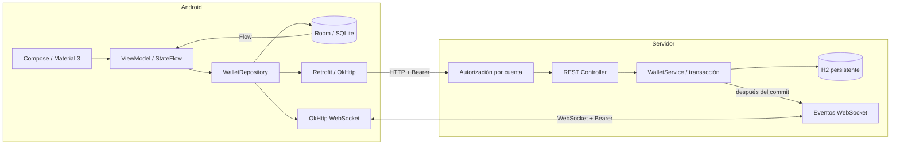
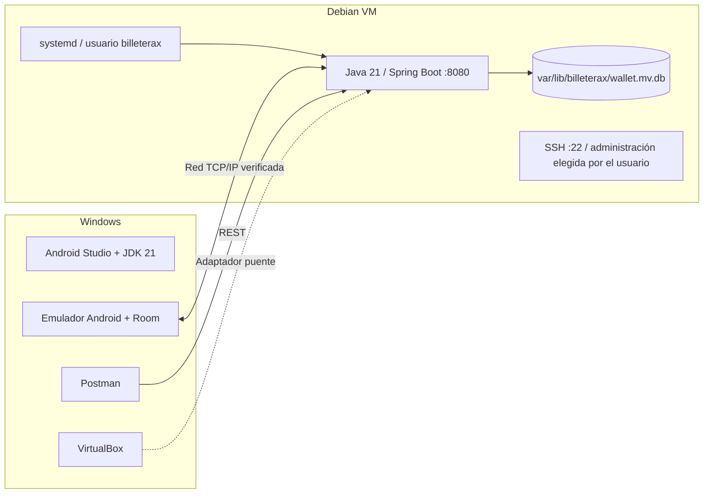
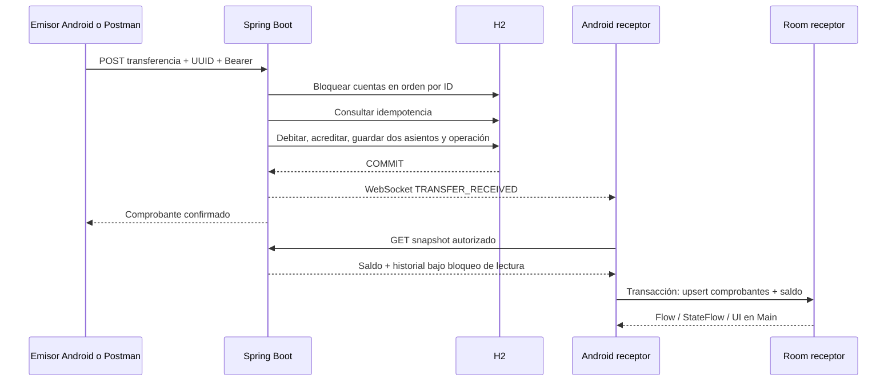

# Arquitectura de BilleteraX

Spring Boot es la autoridad de saldos. Room conserva réplicas locales de comprobantes, nunca decide si un pago fue exitoso. El despliegue usa un único proceso backend y un único archivo H2; no se admite abrir ese archivo simultáneamente desde varios servidores.

## Componentes y cliente servidor

## Despliegue actual

## Secuencia de transferencia

## Consistencia monetaria

Java usa BigDecimal con dos decimales; la base usa DECIMAL(19,2); Android almacena centavos Long. El límite por solicitud y por saldo es 999999999999.99 USD. No se usan Double/Float para dinero.

Cada modificación obtiene bloqueos PESSIMISTIC_WRITE sobre las cuentas en orden alfabético. El bloqueo del origen serializa también solicitudes duplicadas. El UUID se limita a la cuenta emisora mediante la clave `cuenta:UUID` y se guarda una huella del contenido. El débito, crédito, asientos y registro de idempotencia se confirman juntos o se revierten juntos. Las lecturas de snapshot bloquean la cuenta mientras obtienen saldo e historial para impedir una mezcla de dos estados.

Entidades: Account contiene titular de prueba y saldo; LedgerEntry contiene comprobante, categoría, contrato y servicio; WalletOperation mantiene identidad y huella de la operación. El pago simulado se representa como asiento SERVICE; no necesita un proveedor ni una factura externa.

## Seguridad y límites del laboratorio

Registro/login usan nombre de usuario y contraseña, sin correo. WalletUser tiene una cuenta propia de saldo inicial cero; WalletSession guarda el hash SHA-256 de una sesión aleatoria de 256 bits y su vencimiento a 30 días. Las contraseñas usan BCrypt. Usuarios y sesiones viven en la misma H2 persistente. La restricción única de usuario y la transacción protegen registros simultáneos.

El filtro permite POST de registro/login y exige Bearer para los demás recursos de la app. La sesión autoriza solo su cuenta. Cerrar sesión la revoca y cierra su WebSocket después del commit. Se conserva compatibilidad de laboratorio con los tokens estáticos antiguos, sin exigirlos al usuario de Android.

Android cifra la sesión con Keystore y deshabilita backups; no guarda la contraseña. Room separa historia por servidor/cuenta. Debug permite HTTP en la red privada; release exige HTTPS. No hay dinero real ni controles de identidad de un banco productivo.

Los eventos WebSocket no son una cola duradera: la recuperación se realiza por REST. Para la escala académica se descarga el snapshot completo; el endpoint de historial sí pagina. Para historiales grandes se necesitaría un cursor consistente y sincronización incremental. H2 y ddl-auto=update simplifican el laboratorio; antes de escalar se requieren migraciones explícitas y una base de servidor.

## Referencias técnicas consultadas

- [Spring Boot 3.5 y requisitos de Java](https://docs.spring.io/spring-boot/3.5/system-requirements.html)
- [Compatibilidad de AGP 8.13](https://developer.android.com/build/releases/agp-8-13-0-release-notes)
- [Configuración de compileSdk con API menor](https://developer.android.com/build)
- [Room y versiones de AndroidX](https://developer.android.com/jetpack/androidx/releases/room)
